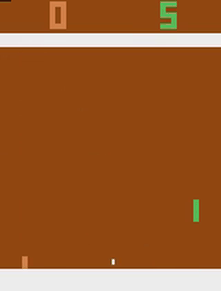
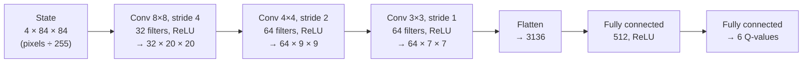
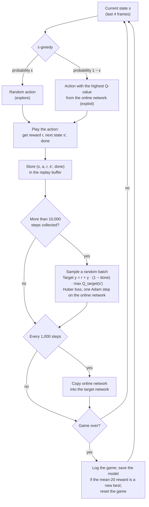
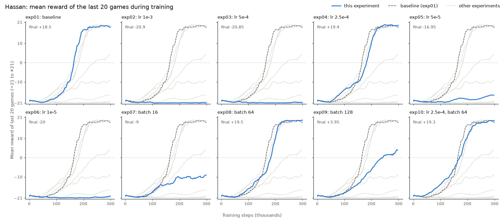
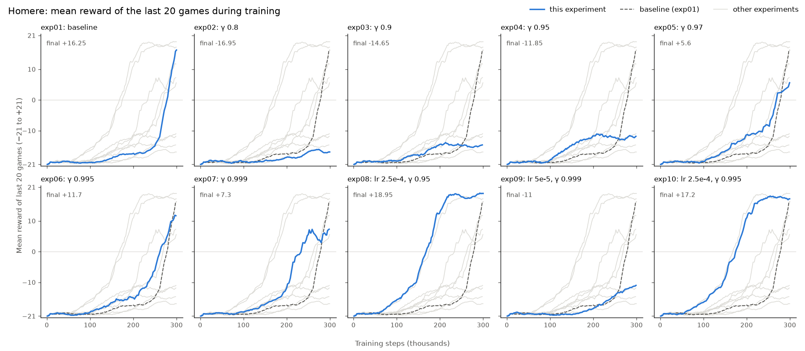
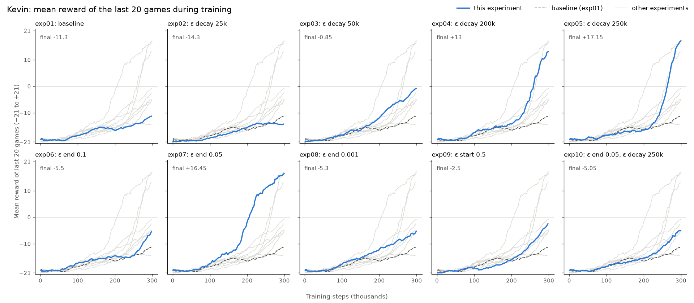
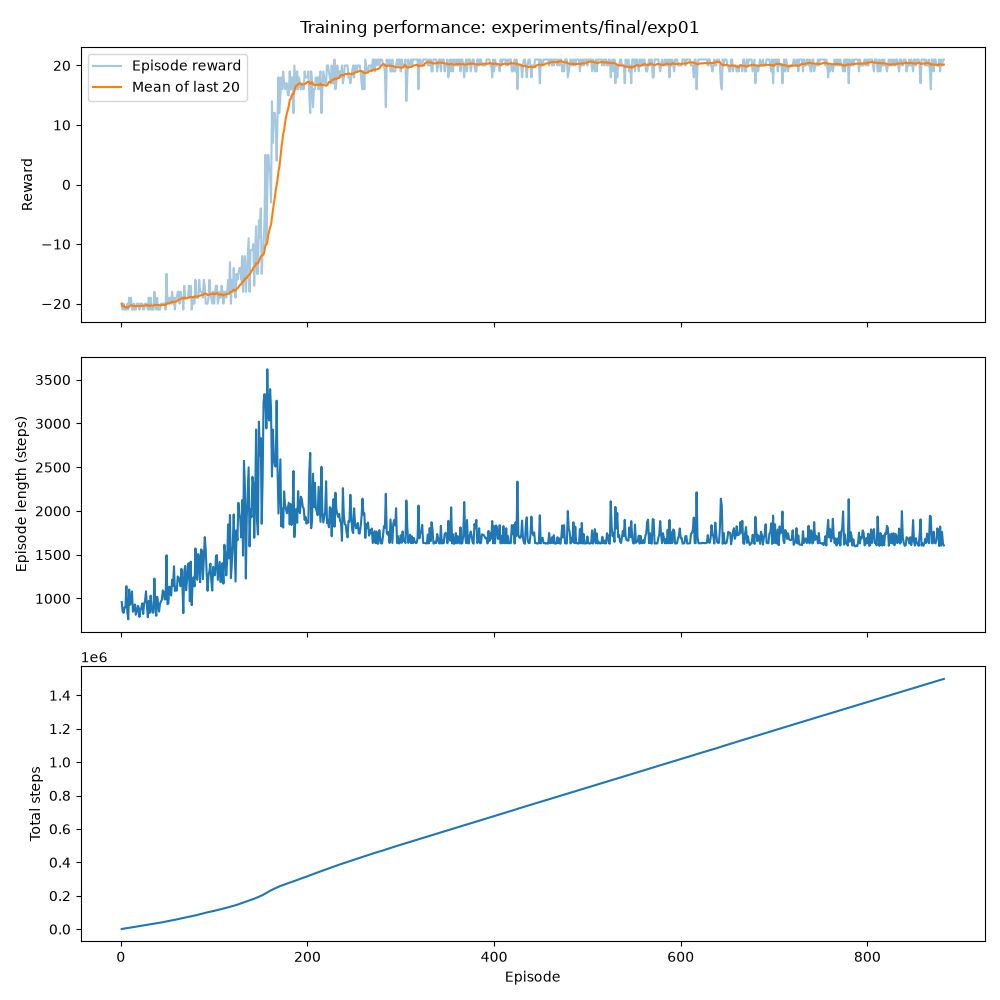

# Group 9: Deep Q-Network on Atari Pong

We built a Deep Q-Network (DQN) from scratch with PyTorch and trained it to play Atari Pong. No reinforcement-learning libraries are used: the Q-network, replay buffer, ε-greedy exploration, Bellman target and training loop are all in [`train.py`](train.py). Gymnasium only provides the game.

Our final model won every game we tested 21–0 against Pong's built-in opponent.



## Group members

| Member | Experiment theme |
|---|---|
| Hassan Adelani | Learning rate and batch size |
| Homere Singizwa | Discount factor (γ) |
| Kevin Kaneza Mbonimpaye | Exploration (ε-greedy schedule) |

## Contents

- [The game](#the-game-alepong-v5)
- [How our DQN works](#how-our-dqn-works)
- [Training process](#training-process)
- [Hyperparameter experiments](#hyperparameter-experiments)
- [Final model: training performance](#final-model-training-performance)
- [Gameplay demo](#gameplay-demo)
- [How to run](#how-to-run)
- [Repository structure](#repository-structure)
- [Contributions](#contributions)

## The game: `ALE/Pong-v5`

- **Objective:** the agent controls the green paddle on the right and plays against the built-in computer opponent on the left. Whoever misses the ball gives the other side a point. A game ends when one side reaches 21 points.
- **Actions:** 6 discrete actions (moving the paddle up or down, staying still, and variants with the fire button). DQN needs a discrete action space, which is why Pong fits.
- **Reward:** +1 when the agent scores, −1 when the opponent scores, 0 otherwise. A game's total reward runs from −21 (lost every point) to +21 (won every point). Rewards are already ±1, so no reward clipping is needed.
- **Why Pong:** plain DQN learns it reliably within a few hundred thousand steps, so each of our 30 experiments could finish in about 30 minutes. Bad settings stay flat at −21 and good ones climb to around +20, so the experiments are easy to compare.

## How our DQN works

### 1. Preprocessing (`make_env`)

A raw Pong screen is 210 × 160 pixels in colour. `make_env` applies the standard preprocessing from the DQN paper with Gymnasium's wrappers:

| Step | Setting | Why |
|---|---|---|
| Frame skip | 4 | The agent chooses an action every 4th frame and repeats it in between. One **step** in this README is one decision, which is 4 game frames. |
| Grayscale | on | Colour is not needed to play Pong. |
| Resize | 84 × 84 | Smaller input, faster network. |
| Frame stack | 4 frames | One frame cannot show which way the ball is moving; 4 consecutive frames show its direction and speed. |
| No-op start | 0–30 random "do nothing" steps | Games start slightly differently, so the agent cannot memorise one sequence. |
| Sticky actions | off (`repeat_action_probability=0`) | As in the original DQN setup. |

Each state is a `(4, 84, 84)` array of `uint8` pixels. Pixels stay as integers in the replay buffer to save memory and are scaled to [0, 1] inside the network.

### 2. Q-network (`QNetwork`)

The network takes a state and outputs one Q-value per action: the expected total discounted reward of taking that action and then playing well. It is the CNN from the DQN Nature paper, with 1.69 million parameters.



### 3. Training loop



The key ideas, and where they are in [`train.py`](train.py):

- **Experience replay (`ReplayBuffer`):** every transition goes into a buffer of the last 50,000. Each update uses a random batch from it. Consecutive frames are almost identical, and random sampling breaks that correlation; each transition can also be learned from many times.
- **Target network:** a second copy of the Q-network, updated only every 1,000 steps by copying the online network's weights. The Bellman targets are computed with it, so they don't shift after every update, which keeps training stable.
- **Bellman target (`train_step`):** `y = r + γ · (1 − done) · max_a′ Q_target(s′, a′)`. When the game really ended (`done = 1`), there is no future, so the target is just `r`. Only `terminated` counts as done: if a game is cut off by a time limit (`truncated`), the next state still has value, so the target keeps the future term.
- **Loss and optimiser:** Huber loss (`smooth_l1_loss`) between Q(s, a) and y. It behaves like squared error for small errors but grows only linearly for large ones, so a few surprising transitions cannot cause huge updates. Gradients are clipped to a norm of 10, and Adam takes one step per environment step.
- **ε-greedy exploration (`get_epsilon`, `select_action`):** ε decreases linearly from `eps_start` to `eps_end` over `eps_decay` steps and then stays at `eps_end`. Early on the agent acts mostly at random to discover what works; later it mostly uses what it has learned. Keeping a small ε lets it keep discovering.
- **Checkpointing:** after every game, if the average reward of the last 20 games (the **mean-20 reward**) is a new best, the model is saved to `dqn_model.pth`. So the saved model is the best point of the run, not necessarily the last.
- **Playing (`play.py`):** loads a saved model and always picks the action with the highest Q-value (ε = 0), because random actions are only needed while learning.

### 4. Settings

Fixed in every run:

| Setting | Value |
|---|---|
| Replay buffer | 50,000 transitions |
| Learning starts after | 10,000 steps |
| Target network update | every 1,000 steps (full copy) |
| Updates | 1 gradient step per environment step |
| Optimiser | Adam, ε = 1.5e-4 (see [Training process](#training-process)) |
| Loss | Huber, gradients clipped to norm 10 |
| Steps per experiment | 300,000 (1.2 million game frames) |

Tuned in the experiments, starting from this **group baseline**: learning rate 1e-4, γ 0.99, batch size 32, ε from 1.0 to 0.01 over 100,000 steps (linear).

## Training process

- **Where it ran:** on Kaggle's free Tesla T4 GPUs. A 300,000-step experiment takes about 30 minutes; each member's exp01–exp09 ran back to back as one Kaggle job of about 4.5 hours. We launched the jobs from the terminal with [`kaggle/launch.sh`](kaggle/launch.sh), or from the notebook [`kaggle/train.ipynb`](kaggle/train.ipynb), and downloaded results with [`kaggle/fetch.sh`](kaggle/fetch.sh). Setup steps are in [`KAGGLE_SETUP.md`](KAGGLE_SETUP.md), and every job's full log is in [`kaggle/logs/`](kaggle/logs/).
- **Same code for every run:** `train.py` was frozen at the git tag `v1-experiments` before the first experiment and has not changed since, so all 31 runs (30 experiments and the final model) use identical training code. Only the command-line hyperparameters differ. The exact commands are in `experiments/<Name>/run_experiments.sh`, and every run folder has a `config.json` with all its settings.
- **Experiment design:** each member varied one theme and used their own seed (Hassan 1, Homere 2, Kevin 3). Exp 1 is always the group baseline. Exp 2–9 change one thing at a time (Homere's exp 8 and 9 change γ and the learning rate together). Exp 10 combines the best findings, including teammates' results.
- **Metric:** the mean-20 reward, the average reward of the last 20 games. "Started improving" means the first step at which it rose above −19.
- **A bug we found and fixed before the experiments:** with Adam's default ε of 1e-8, every seed-1 test run stayed at −21, even after 1 million steps. All the units in the third conv layer stopped firing within about 9,000 updates ("dying ReLU"), so the network gave the same Q-values for every frame. Pong frames are mostly the same background, so many gradients are tiny, and with ε = 1e-8 Adam still turns a tiny gradient into a full learning-rate step. Setting Adam's ε to 1.5e-4, as in the Rainbow DQN paper, damps those updates. After the fix, seeds 1, 2 and 3 all learned within 300,000 steps.
- **Final model:** the best settings from all 30 experiments, trained 5 times longer (see [below](#final-model-training-performance)).

## Hyperparameter experiments

Each member ran 10 experiments of 300,000 steps. The full tables, with observed behaviour for every run, are in:

- [HassanHyperparameter_experiment_results.md](HassanHyperparameter_experiment_results.md): learning rate and batch size
- [HomereHyperparameter_experiment_results.md](HomereHyperparameter_experiment_results.md): discount factor γ
- [KevinHyperparameter_experiment_results.md](KevinHyperparameter_experiment_results.md): ε-greedy exploration

Each run's model, training log (`training_log.csv`), plots (`training_plots.png`) and settings (`config.json`) are in `experiments/<Name>/exp01` to `exp10`.

Summary (scores are the final mean-20 reward at 300,000 steps):

| Member (theme) | Best run | Worst run | Main finding |
|---|---|---|---|
| **Hassan** (learning rate, batch size) | exp 4, learning rate 2.5e-4: **+19.4** (best +19.7). Batch 64 (exp 8) reached +19.5. | exp 2 and 3, learning rates 1e-3 and 5e-4: **−20.9**. The network died early: whole ReLU layers stopped firing. | The useful learning rate range is narrow. Between 1e-4 and 2.5e-4 the agent learns well; above it, updates kill units for good; below it (5e-5, 1e-5), learning is too slow to win games in 300k steps. Batch 64 matched the best result, 16 learned more slowly, and 128 took 1.6× as long to run. |
| **Homere** (discount factor γ) | exp 8, γ 0.95 with learning rate 2.5e-4: **+18.95** | exp 2, γ 0.80: **−16.95** | The agent looks about 1/(1−γ) steps ahead: 5 steps for γ 0.80, 100 for γ 0.99. In Pong the point is scored at the end of a long rally, so a short horizon cannot connect hitting the ball to scoring. At learning rate 1e-4, every γ of 0.95 or below stayed negative. Between γ 0.95 and 0.995 the learning rate mattered more than γ: raising it to 2.5e-4 took γ 0.95 from −11.85 to +18.95. |
| **Kevin** (exploration ε) | exp 5, ε decay over 250k steps: **+17.15** | exp 2, ε decay over 25k steps: **−14.3** | The length of the ε decay had the biggest effect. Going greedy after 25k steps locks in a policy learned from almost no experience, while the long decays gave the most varied experience and the highest scores. A final ε of 0.05 was best with the 100k decay (+16.45), but combining it with the 250k decay gave only −5.05 (exp 10): the two settings interact, so the best values cannot simply be stacked. |

**Run-to-run variation:** the three baselines (exp 1) used identical settings and differed only in seed. They ended at +18.5 (Hassan, seed 1), +16.25 (Homere, seed 2) and −11.3 (Kevin, seed 3). Single runs of 300,000 steps vary a lot, so only large gaps (learning versus not learning, collapse versus no collapse) are meaningful, not differences of a few points.

### Comparison plots

Each figure has one panel per experiment. The panel's run is in blue, the member's baseline (exp01) is dashed, and the other nine runs are in light gray for context. The y-axis is the mean-20 reward, from −21 (losing every point) to +21 (winning every point). Made with `uv run plot_experiments.py <Name>`.

**Hassan: learning rate and batch size**



**Homere: discount factor γ**



**Kevin: ε-greedy exploration**



## Final model: training performance

We combined the best settings from all three members and trained for 1.5 million steps, 5 times the experiment budget ([`experiments/final/run_experiments.sh`](experiments/final/run_experiments.sh)):

| Setting | Value | Chosen because |
|---|---|---|
| Learning rate | 2.5e-4 | Hassan's best learning rate (exp 4, +19.4); also used in Homere's best run (exp 8, +18.95) |
| Batch size | 64 | Hassan's best batch size (exp 8, +19.5). Together with learning rate 2.5e-4 (Hassan's exp 10), it started improving earliest of all 30 runs (~50k steps). |
| γ | 0.99 | Homere's recommendation: with learning rate 2.5e-4, γ 0.95–0.995 all ended within about 2 points, and 0.99 was the best of them (Hassan's exp 4) |
| ε | 1.0 → 0.01 over 250,000 steps | Kevin's best run (exp 5, +17.15) and his recommendation for a long run |
| Steps | 1,500,000 | 5 × the 300,000 used in every experiment |



**Results** (training ran for 2 h 59 min on a Kaggle Tesla T4, about 141 steps per second):

- **Reward (top panel):** the mean-20 reward started improving at about 68k steps, passed 0 at about 252k and +15 at about 284k. It reached its best, **+20.75**, at 799,499 steps; that checkpoint is the saved model, [`dqn_model.pth`](dqn_model.pth). After 500k steps the mean-20 never fell below +19.6, and the agent won all 293 games it played after 1 million steps (its lowest score was +16).
- **Episode length (middle panel):** games got longer at first, peaking at 3,620 steps in game 157, because the agent learned to return the ball before it learned to score, which made rallies long. Once it won points quickly, games settled at about 1,700 steps.
- **Total steps (bottom panel):** 1.5 million steps (6 million game frames) over 882 games. The curve is steeper in the middle because the long games of that phase each covered more steps.
- **Playing greedily:** with `play.py` on a CPU laptop (ε = 0), the final model won every game we tested 21–0.

## Gameplay demo


The agent is the green paddle on the right; the built-in opponent is the orange paddle on the left. The GIF is an 11-second clip; the full game, which the agent won 21–0, is in [`videos/gameplay.mp4`](videos/gameplay.mp4) (1 min 48 s, real speed). Both were recorded with `uv run play.py --record --episodes 1`.

## How to run

You need [uv](https://docs.astral.sh/uv/getting-started/installation/); it installs Python 3.12 and every dependency. Do not use pip.

```bash
git clone https://github.com/Hassan-Adelani-Luqman/group-9-atari-dqn.git
cd group-9-atari-dqn
uv sync    # the first time downloads a few GB (PyTorch)
```

**Watch the trained agent** (runs on a CPU):

```bash
uv run play.py                     # final model (dqn_model.pth), 3 games in a window
uv run play.py --episodes 1 --model experiments/Kevin/exp05/dqn_model.pth   # any experiment's model
uv run play.py --record            # save each game as an mp4 in videos/ instead of showing it
```

**Train:**

```bash
uv run train.py --member test --exp 0 --total-steps 20000                  # quick check that training runs
uv run train.py --member yourname --exp 1 --lr 2.5e-4 --batch-size 64      # your own experiment
bash experiments/final/run_experiments.sh                                  # retrain the final model (about 3 h on a T4 GPU)
```

Results go to `experiments/<member>/exp<NN>/`: `dqn_model.pth`, `config.json`, `training_log.csv` (one row per game) and `training_plots.png`. A 300,000-step run takes about 30 minutes on a T4 GPU and much longer on a CPU; [`KAGGLE_SETUP.md`](KAGGLE_SETUP.md) explains how to run on Kaggle's free GPUs from the terminal.

| Option | Default (group baseline) | Meaning |
|---|---|---|
| `--member`, `--exp` | required | name and number of the output folder |
| `--seed` | 1 | random seed |
| `--lr` | 1e-4 | learning rate |
| `--gamma` | 0.99 | discount factor |
| `--batch-size` | 32 | transitions per update |
| `--eps-start`, `--eps-end` | 1.0, 0.01 | ε at the start and after the decay |
| `--eps-decay` | 100000 | steps over which ε decreases linearly |
| `--total-steps` | 300000 | length of the run |

**Compare a member's experiments:**

```bash
uv run plot_experiments.py Hassan    # saves experiments/Hassan/comparison.png
```

## Repository structure

```
group-9-atari-dqn/
├── train.py                       # DQN from scratch: preprocessing, Q-network, replay buffer, training loop
├── play.py                        # loads a model and plays greedily (window or --record)
├── plot_experiments.py            # one figure comparing a member's 10 experiments
├── dqn_model.pth                  # final model (copy of experiments/final/exp01/dqn_model.pth)
├── experiments/
│   ├── Hassan/   exp01 … exp10/   # each: dqn_model.pth, config.json, training_log.csv, training_plots.png
│   ├── Homere/   exp01 … exp10/
│   ├── Kevin/    exp01 … exp10/
│   └── final/    exp01/           # the 1.5M-step final run
│   (each member folder also has run_experiments.sh, the exact commands for its 10 runs,
│    and comparison.png, all 10 runs in one figure)
├── HassanHyperparameter_experiment_results.md
├── HomereHyperparameter_experiment_results.md
├── KevinHyperparameter_experiment_results.md
├── kaggle/                        # launch.sh, fetch.sh, job.py, train.ipynb, logs/ of every Kaggle job
├── KAGGLE_SETUP.md                # how to run experiments on Kaggle GPUs
├── videos/                        # gameplay.mp4, gameplay.gif
└── pyproject.toml, uv.lock, .python-version
```

## Contributions

| Member | Code | Experiments | Documentation |
|---|---|---|---|
| **Hassan Adelani** | Project and uv setup; the DQN core of `train.py` (`QNetwork`, `ReplayBuffer`, ε-greedy, `train_step`, training loop, checkpointing); the Adam ε fix; the Kaggle runner (`kaggle/`); `play.py`; `plot_experiments.py` | 10 learning-rate and batch-size runs; the 1.5M-step final model | Hassan's results file; `KAGGLE_SETUP.md`; README; gameplay video and GIF |
| **Homere Singizwa** | `make_env` (Atari preprocessing), the CSV training log and the training plots in `train.py` | 10 discount-factor runs | Homere's results file |
| **Kevin Kaneza Mbonimpaye** | `run_experiments.sh` for all three members | 10 exploration runs | Kevin's results file |

Each member committed their own experiment results from their own GitHub account on their own branch, and they reached `main` through pull requests. The git history shows who wrote each part.
